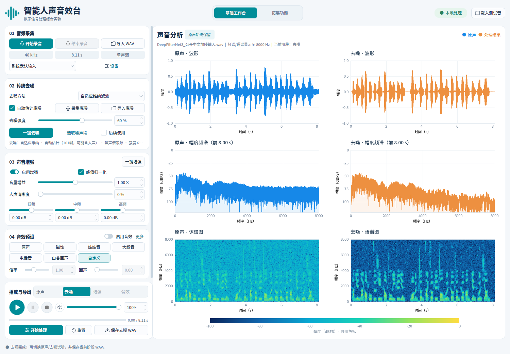

# 智能人声音效台

[GitHub 仓库](https://github.com/QQ-D/project)

数字信号处理综合实验，Python 桌面版。界面已按选定的[第一版浅色工作台](docs/浅色工作台设计与验收.md)落实；早期[v2设计](design/界面设计说明.md)保留作实验要求对照。



浅灰背景、白色圆角卡片与蓝绿色操作区；基础四卡、固定试听/保存区，拓展页共用同一主题。“设备”展开采样率和输出设备，“更多”展开电话滤波及回声细节。

## 当前已实现：DeepFilterNet3 降噪、高级音效、中文 TTS 与 BP 训练

- 基础工作台默认自适应维纳60%，保留谱减与底噪采集/导入/选段；拓展页分为高级音效、中文TTS、智能降噪三个子页。
- 智能降噪默认DeepFilterNet3预训练模型，通过已有dbaf环境在CPU处理，无需训练或底噪参考；与固定维纳60%同源比较，可保留BP结果共同试听、六图和导出。

- 小型BP网络真实训练、逐轮损失、独立训练数据、本项目NPZ模型保存/加载；与自动维纳进行独立缓存试听/六图/导出对比，有干净演示参考才计算SNR。

- 中文 TTS 离线生成、独立试听/保存，明确送入工作台后制作配音；使用本机 eSpeak NG 基础普通话，固定音色、声音偏机械。
- 独立变调/变速、房间混响、机械电音、动态压缩已接通；六个音效节点可排序串联，图形、试听和导出一致。
- 基础、TTS、智能降噪共享实时试听音量0–100%及静音，不改缓存/导出；进一步放大可用增强增益或压缩补偿。

- 扩展页多重回声已接通：1–8次逐次衰减，复用主工作台延时/强度，保留所有尾音；与基础工作台共用音效缓存及导出。
- 基础音效已接通：0.50–2.00×真实倍率、电话带通、带尾音的单次回声，以及磁性/娃娃音/大叔音/电话音/山谷回声五种预设。
- 原声/去噪/增强/音效四阶段缓存切换，图形、试听与导出使用同一份样本。
- 基础页提供自适应维纳与功率谱减，可显式选择；各方法均贯穿增强/音效链路。
- 导入待处理语音即可“一键去噪”，无需独立噪声文件、噪声选段或麦克风采集；传统模式另外支持自动估计底噪。
- 独立声音增强：峰值归一化到0.95、音量增益0–2×、人声清晰度0–100%、低/中/高三段均衡各±12dB。
- 原声直接增强，或勾选“后续使用”先去噪再增强；可与音效串联，试听、图形与导出一致。
- 麦克风录音、结束、取消，输入设备与目标采样率选择；实际格式以设备为准，结束后进入真实分析、试听和保存。
- 环境底噪独立采集，约 1.5 秒自动停止，不覆盖原声。
- 无麦克风也可使用：独立导入底噪 WAV，确认只有噪声且与原声环境匹配后去噪；支持先导入原声或先导入底噪。
- 波形拖选或数值选择纯噪声片段，支持试听；至少 0.10 秒，需显式确认没有人声。
- 底噪来源、时长、采样率与确认状态管理，支持确认沿用和清除。
- 维纳与功率谱减去噪，强度0–100%；底噪采样率不同时内部重采样参考，结果保持原声长度与采样率。
- 原声/去噪缓存切换、真实六图比较、所选阶段试听与PCM16 WAV导出；参数或参考变化立即清除旧去噪结果。
- WAV 导入，显示真实采样率、时长及源声道数；立体声转单声道。
- 同一阶段缓存的真实波形、幅度频谱、语谱图。频谱分析最多取前 8 秒，图标题显示实际时长；语谱图覆盖整段，长音频均匀抽帧显示。
- 输出设备选择，原声播放、暂停、继续、停止、进度、末尾重播；设备不可用时显示明确错误。
- 原声、去噪、增强与音效结果保存为 PCM16 WAV，不做隐式归一化。
- 后台导入、去噪、增强、分析与保存；损坏文件不覆盖已有原声；后台任务结束后安全关闭窗口。

**尚未实现**：CNN训练与智能去混响。DeepFilterNet3与小型BP均在“拓展功能 → 智能降噪”；BP提供训练、本项目模型加载，统一与维纳比较。03区域为均衡增强，04区域为基础音效，其余高级音效和中文TTS在各自拓展子页。当前布局与截图见[课程界面说明](docs/课程界面与智能对比.md)。

## 运行

已盘点本机环境，选择 Conda base 的 Python 3.13.5 + 已有 PyQt5、Matplotlib、NumPy、SciPy。详见 [环境检查](docs/环境检查.md)。没有修改 base 或其他既有环境。

项目当前位于 `/media/rwj/ZX1 2TB/综合实验`，已保留 `.venv-run`，在该目录可以直接启动：

```bash
bash run.sh
```

先用附带合成测试音体验导入与分析：

```bash
bash run.sh --demo
```

也可指定自己的文件：

```bash
bash run.sh --file /绝对路径/录音.wav
```

如果 `.venv-run` 不存在，本机可通过以下方式重建，复用 base 包：

```bash
/home/rwj/anaconda3/bin/python -m venv --system-site-packages .venv-run
```

在其他电脑上建议用 Python 3.11 或更新版本创建独立虚拟环境，再安装 `requirements.txt`；固定版本记录的是本机验证组合。Linux 还需桌面 Qt 所依赖的图形和音频系统库、可用音频输出设备，以及中文字体。字体优先 Noto Sans CJK；Windows 可使用微软雅黑。离线中文TTS另需系统eSpeak NG库及cmn语言数据；本机已有，缺失时该模块显示不可用原因，不影响其他处理。

DeepFilterNet3使用已有 `/home/rwj/anaconda3/envs/dbaf/bin/python` 独立进程（Python3.10.11、torch2.0.1、torchaudio2.0.2、deepfilterlib0.5.6），主界面继续使用 `.venv-run`。已拷入必要源码与模型并保留上游许可；运行不再依赖外置盘工程路径。未安装或升级既有环境。

## DeepFilterNet3 智能降噪

1. 从基础工作台导入WAV，打开“拓展功能 → 智能降噪”。默认模型为DeepFilterNet3，混合100%。
2. 点击“运行 DeepFilterNet3 / 维纳比较”，无需训练、采集/导入底噪或选择噪声段。
3. 下拉框选择原声、传统维纳、DeepFilterNet3或已运行的BP结果，试听、右侧六图和WAV导出共用缓存。没有干净参考时SNR显示“—”。
4. 需要继续增强和音效时，点击“送入主工作台作为新原声”；运行比较本身不会覆盖基础页原声和处理结果。

100%使用完整模型，中间值为原声/模型混合，0%精确旁路。模型内部使用48kHz，输出恢复原采样率和精确长度。长音频分段及上下文用于控制内存；进程失败保留已有有效结果。基础“重置”恢复维纳60%，不会改变有效智能比较。

[接入原理、来源与验收](docs/DeepFilterNet3降噪验收.md) · [当前智能界面](artifacts/课程界面_智能降噪对比.png) · [公开中文降噪样例](artifacts/DeepFilterNet3_公开中文降噪输出.wav)

## 中文 TTS 与高级音效

1. 打开“扩展功能 → 中文 TTS”，输入中文并点击“生成中文语音”，可独立试听或保存WAV。最多400字符，合成语速0.50–2.00×，文字仅在本机处理。
2. 点击“送入工作台作为原声”才会替换当前原声，随后可应用去噪、增强、均衡和各类音效。
3. “拓展功能 → 高级音效”勾选独立变调/变速、房间混响、机械电音或动态压缩；向下滚动可上下调整串联顺序，点击“应用高级音效并返回工作台”。独立变调保持时长，独立变速保持音高；基础倍率仍会同时改变二者。
4. 完成后切换“原声/音效”对比，保存当前阶段。基础、TTS、智能三页试听音量/静音实时同步；100%为原有电平，需要更响用03增益或压缩补偿后重新处理。

[完整参数、原理与验收](docs/高级音效与中文TTS验收.md) · [扩展页截图](artifacts/高级音效与中文TTS_扩展页.png) · [公开中文合成样例](artifacts/中文TTS_公开测试句.wav)

## BP 智能降噪与传统方法对比

打开“拓展功能 → 智能降噪”，选择“小型 BP · 教学训练”，点击“训练小型 BP 网络”，或“加载模型 NPZ”选择 [附带教学模型](artifacts/教学BP_公开合成模型.npz)。默认公开合成数据，20轮/批大小128；也可导入2–60秒干净WAV自动加噪训练。无需安装新依赖或下载模型。

点击“载入公开加噪演示”再“运行 BP / 维纳比较”，可在“原声/传统维纳/小型 BP”之间切换试听、查看六图、保存WAV。自己的录音先从工作台导入即可比较；没有干净参考时SNR显示“—”。明确点击“送入主工作台作为新原声”后可继续增强或制作音效。

这是教学用8→16→1频谱掩膜网络。独立合成演示的输入SNR约5dB，BP和维纳都约13.91dB，不能由此推断真实语音效果或宣称BP更好。内部最高16kHz分析，高采样率内容可能损失8kHz以上频率；0%强度精确旁路。

[完整原理与验收](docs/BP智能降噪验收.md) · [比较面板](artifacts/BP降噪_比较面板.png) · [六图](artifacts/BP降噪_智能六图.png)

## 基础去噪：自动估计底噪

维纳已针对风扇背景残留优化，36组公开中文对照中风扇停顿噪声衰减均值由2.81提高至13.60dB；嘶声改善较小。详见[开源调研、完整数据及新旧试听](docs/维纳背景噪声优化.md)。

1. 关闭旧窗口，运行 `bash run.sh`，用“导入 WAV”载入待处理语音。
2. 基础页默认“自适应维纳滤波”，底噪采集/导入/选段控件一直显示。保持勾选“自动估计底噪（直接去噪）”，点击“一键去噪”或“开始处理”。
3. 完成后在底部切换“原声/去噪”试听、查看六图，按需“保存去噪 WAV”。
4. 传统方法可先设60%试听，再按效果调整。自动估计模式需要至少0.10秒原声；0%是精确旁路，不估计背景谱。

自动方法从原声非全零帧中选择能量最低的10%初始化背景谱。维纳结合逐频点时间稳定性保留背景峰，保护随发声变化的谐波；谱减沿用原有中值谱限制。估计帧可能包含语音，并不等同于确认过的纯底噪；更适合稳定宽带背景噪声，连续说话、音乐、窄带嗡声及复杂噪声的效果可能有限。需要更准确参考时，仍可导入或选取同环境底噪。

选择、采集或导入底噪时，会自动关闭“自动估计”并切到参考模式；文件参考仍需确认适用。重新勾选自动估计可忽略保留的参考直接处理。切换模式会清除旧去噪缓存，“清除底噪”会回到自动估计。

维纳自动模式会逐帧跟踪背景谱，并用平滑增益抑制噪声；参考模式使用固定已确认的参考谱。02区域可切换“功率谱减”复现原算法。方法变化使相关下游缓存失效；“重置”恢复基础默认维纳60%。传统方法详情见[维纳降噪原理与历史验收](docs/维纳降噪验收.md)。

[新版维纳实际界面](artifacts/维纳去噪实际界面.png) · [历史自动谱减界面](artifacts/自动去噪实际界面.png)

## 声音增强与三段均衡

1. 导入WAV后，在左侧向下滚动到“03 声音增强”，点击“一键增强”。它会自动勾选“启用增强”，默认峰值归一化到0.95、增益1×、清晰度与EQ均为0。
2. 也可先勾选“启用增强”调参：音量0–2×、清晰度0–100%、低/中/高频各−12至+12dB，再点“一键增强”或“开始处理”。关闭增强时参数保留并置灰。
3. 默认直接增强原声，不要求底噪。需要先去噪时，勾选02区域“后续使用”；软件复用有效去噪缓存，没有缓存则在同一后台任务先去噪再增强。手动参考模式依旧要求底噪确认。
4. 完成后自动选中“增强”，底部切换“原声/去噪/增强”试听，右列跟随选中阶段。保存按钮显示当前阶段并导出相同缓存。重复点增强从原声/去噪输入重新计算，不叠加上次增强。
5. 更改增强参数只清除增强结果；更改去噪参数会清除去噪及依赖它的增强，直接来自原声的增强仍保留。更换原声清空全部处理缓存。
6. “重置”恢复基础维纳60%处理，关闭增强、关闭去噪输入策略、归一化选项打开、增益1×、清晰度/EQ为0，保留原声与参考底噪。

处理顺序为EQ/清晰度→可选峰值归一化→用户增益。开启归一化时，增益0.5×对应峰值0.475；增益大于约1.05×可能限幅，界面会显示限幅样本数。关闭归一化可保持原始电平并只应用EQ/增益。清晰度是预设的均衡倾向，增强也可能放大残留底噪，不能把更响等同于去噪或语音质量提升。

[第四阶段实际界面](artifacts/第四阶段实际界面.png) · [第四阶段验收](docs/第四阶段验收.md)

## 音效预设、倍率与回声

1. 导入WAV，向下滚动到04区域，选择“磁性 / 娃娃音 / 大叔音 / 电话音 / 山谷回声”，再点“更多 → 应用音效”或左下“开始处理”。选择预设先加载参数，处理完成后自动选中“音效”。
2. 在04区域手动调节倍率与回声强度；点击“更多”展开电话滤波与回声延时；手动修改音效或增强参数后显示“自定义”，重新处理即可。点击“应用音效”会自动打开“启用音效”。
3. 倍率0.50–2.00×同时改变语速与音高，实际样本和导出时长一起变化；回声延时0–1秒、强度0–0.80，保留一次延迟尾音。电话带通约300–3400Hz，低采样率时约束截止频率。
4. 音效输入从原声开始，按“后续使用”和“启用增强”的选择依次经过去噪、增强，再执行基础倍率与可排序音效节点。默认高级模块关闭时仍为倍率→电话滤波→回声。有效上游缓存会复用，没有缓存时同一后台任务补齐。重复应用不会叠加旧音效。
5. “原声”预设只旁路音效，保留此前增强与去噪策略。完全未经处理的音频请在底部试听区选择“原声”。四个阶段可即时切换，按当前阶段保存WAV。
6. 磁性、娃娃音、大叔音会打开增强并设置均衡；电话音、山谷回声保留现有增强参数。增益和归一化由用户控制，输出越界会限幅并显示数量；回声叠加可能过载，可降低03区域增益。

输入上限仍为300秒；减速与回声可以得到超过300秒的输出，但当前导入器不能重新载入超过300秒的文件。单份音效输出最多128MiB float32缓存，超过时在分配前报错并保留已有结果。五种预设是可解释DSP风格，实际语音效果需试听调整。

[第五阶段实际界面](artifacts/第五阶段实际界面.png) · [参数与验收说明](docs/第五阶段验收.md)

## 多重回声（选做已实现）

导入WAV后，打开“扩展功能 → 多重回声”，设置1–8次、0–1秒间隔、0–0.80强度/衰减，点击“应用多重回声并返回工作台”。按钮自动启用音效；强度为0时先初始化为0.45。每一次按强度系数继续衰减，输出保留最后一次完整尾音。

勾选多重模式也会启用主工作台音效，可从“开始处理”或“应用音效”运行。两页间隔/强度双向同步；工作台显示有效次数与最终延迟，试听/图形/导出使用同一份音效缓存。关闭多重模式恢复单次回声；选择非自定义基础预设会关闭多重模式，重置将次数恢复3、强度0。

[扩展页截图](artifacts/多重回声扩展页.png) · [工作台截图](artifacts/多重回声工作台.png) · [使用原理与验收](docs/多重回声验收.md)

## 传统实验：录音与底噪参考

以下底噪操作在基础页始终显示；默认维纳支持自动估计。拓展页DeepFilterNet3无需这些步骤。

**本机无法使用麦克风时，可直接使用自动去噪；也可用已有WAV提供底噪参考。**

1. 选择输入设备，点击“设备”展开目标采样率和输出设备。支持 16、44.1、48 kHz；目标采样率不受支持时使用设备支持的实际 PCM 格式，元信息显示实际值。
2. 本机默认 ALSA 输入可能不可用，建议选择 `plughw:CARD=Generic,DEV=0`。已只读确认它支持上述三种采样率的单声道 PCM16，未自动采集麦克风内容。
3. 点击“采集底噪”，保持安静，约 1.5 秒后自动结束；也可以手动结束或取消。底噪与原声分别保存在内存中。
4. 点击“开始录音”再说话，点击“结束录音”结束；底部固定的方形停止按钮也可结束录音。最长 300 秒，原始采集缓冲区上限 128 MiB。录音中不能同时导入、保存、播放或再次采集。
5. 结束后后台分析，成功后替换原声；空录音、取消和设备错误均保留已有有效原声及底噪。关闭窗口会取消未完成采集，不自动保存录音。
6. 选择输出设备后试听，并按需要保存原声 WAV。

## 从已有音频选择底噪

1. 先导入或录制音频，点击“选取噪声段”。
2. 在波形上拖动选区，或输入起止时间；可点击“试听选段”和“停止试听”。
3. 确认该区间只有环境底噪、没有说话声后勾选确认框，再点击“采用选段”。更改区间会撤销旧确认。原声不会被裁剪。
4. 换成新的原声后，来自旧原声的选段会清除。独立麦克风底噪在导入新文件后标为待确认；同一输入设备继续录音可沿用已确认底噪。
5. 更换输入设备后，底噪也会标为待确认；确认环境一致后点“确认底噪适用”，否则重新采集或清除。

## 无麦克风：导入底噪

1. 点击“导入 WAV”，载入待处理语音。
2. 在02区域点击“导入底噪 WAV”，选择独立的环境噪声文件。该文件不会替换原声；导入后显示文件名、时长、采样率和待确认状态。
3. 确认文件没有说话声，且噪声与原声来自相同环境，再点击“确认底噪适用”。之后可以“一键去噪”。
4. 底噪至少0.10秒；支持与原声不同的采样率，算法会在内部匹配参考。支持的WAV格式和大小/时长限制与原声导入相同。
5. 也可先导入底噪再导入原声；更换原声后需重新确认底噪是否适用。导入损坏或过短文件、取消选择均保留旧的有效数据。

可直接用项目提供的合成文件验证：原声选择 `samples/去噪测试_人工加噪.wav`，底噪选择 `samples/去噪测试_独立底噪.wav`，确认后以60%去噪。`去噪测试_干净参考.wav` 是客观测试的干净参考，不能当作底噪。

如果没有独立噪声文件，可从已导入语音的停顿处用“选取噪声段”截取纯噪声，同样不需要麦克风。真实录音应使用匹配的环境噪声；附带的合成白噪声只适合合成实验，不能保证用于任意真实语音都有好效果。界面示例见 [底噪导入截图](artifacts/底噪导入实际界面.png)。

参考模式确认底噪后即可运行谱减；自动模式不需要参考。更换原声、底噪、去噪模式或强度后，旧缓存失效，需重新处理；参考模式更换输入设备后需重新确认底噪。导入失败、录音取消或采集失败保留原有有效数据。

## 去噪与对比

1. 基础默认维纳60%自动估计底噪，可直接处理导入或录制语音。也支持导入/采集同环境底噪，或从语音停顿处选取≥0.10秒且没有说话声的参考。
2. 参考模式先确认适用，默认强度60%，可按效果调整。点击“一键去噪”或“开始处理”，后台计算期间其他采集/导入/调参操作暂时禁用。
3. 完成后自动选中“去噪”，右列显示实际结果，左列始终为原声。点底部“原声/去噪”可即时切换缓存；切换会停止旧播放并从新阶段开头试听。右列跟随当前阶段。
4. “保存原声 WAV / 保存去噪 WAV”随所选阶段变化，导出与试听使用同一份样本。强度0%为精确旁路；不自动增益，重建越界时限幅并显示样本数量。
5. 改变强度或模式后需重新点击去噪。“重置”恢复默认参数与增强旁路，清除处理结果，保留原声和参考底噪。

可用提供的人工加噪样本直接体验：

```bash
bash run.sh --file samples/去噪测试_人工加噪.wav
```

这个样本可以直接自动去噪，也可选取前0–0.35秒纯合成白噪声进行参考去噪。另附干净合成参考与独立合成底噪，可复现已知参考的客观验收；均非真人录音。谱减强度过大可能损伤细节或产生音乐噪声，需以实际试听调整。无干净参考的真实录音不显示SNR。

## 文件导入与试听流程

1. 导入 WAV，或点击右上“载入合成测试音”。合成测试音由多个音调与少量噪声构成，**不是真人语音，也不作为去噪效果证据**。
2. 检查左侧元信息与右侧原声三幅图。
3. 输出设备默认“自动选择（优先系统默认）”，点击播放；暂停后点击继续；停止将进度归零。Linux ALSA 默认输出打不开时，程序会尝试独立声卡路由，并将下拉框切换到实际采用的设备。本机回退到 `plughw:CARD=Generic,DEV=0`，也可手动选择它。
4. 选择原声或有效去噪/增强阶段后保存，导出当前所选缓存。源音频不会自动归一化或套用任何灰色控件效果。

当前版本输入上限为 300 秒、128 MiB；支持常见整数 PCM、浮点 WAV。空文件、NaN/Inf 和超出 ±1 的浮点幅度会报错。读取立体声后逐帧平均声道。PCM16 导出存在正常的量化误差，不是字节级复制原 WAV。

设备不支持源采样率或单声道 PCM16 时，播放器按 Qt 返回的设备支持格式重采样/调整输出声道；此转换仅用于播放，不改变原声缓存或导出采样率。沙箱内枚举不到设备；在桌面权限下已验证默认 ALSA 启动失败后自动回退到 Generic，2 秒全零静音通过真实 GUI 的播放、暂停、继续、自然结束、重播与停止。静音状态验证不能替代真实语音的听感检查。

如果仍报错，在“输出设备”下拉框手动选择已连接的扬声器或耳机，检查连接和系统音量。显式选择设备失败时不会自动切换到其他扬声器；启动失败会显示设备和 Qt 错误码。修改代码后须关闭旧窗口，重新运行 `bash run.sh`。

## 验证

```bash
QT_QPA_PLATFORM=offscreen .venv-run/bin/python -m pytest -q
QT_QPA_PLATFORM=offscreen .venv-run/bin/python -m scripts.verify_light_ui
QT_QPA_PLATFORM=offscreen .venv-run/bin/python -m scripts.verify_denoise
QT_QPA_PLATFORM=offscreen .venv-run/bin/python -m scripts.verify_enhancement
QT_QPA_PLATFORM=offscreen .venv-run/bin/python -m scripts.verify_effects
QT_QPA_PLATFORM=offscreen .venv-run/bin/python -m scripts.verify_wiener
QT_QPA_PLATFORM=offscreen .venv-run/bin/python -m scripts.verify_multiecho
QT_QPA_PLATFORM=offscreen .venv-run/bin/python -m scripts.verify_advanced_tts
QT_QPA_PLATFORM=offscreen .venv-run/bin/python -m scripts.verify_neural
QT_QPA_PLATFORM=offscreen .venv-run/bin/python -m scripts.verify_deepfilter
```

当前完整回归 **468项通过（134.30秒）**，详见[开发进度](docs/开发进度.md)和[浅色工作台验收](docs/浅色工作台设计与验收.md)。验收脚本生成公开合成样本的真实GUI截图、阶段导出与JSON数据；当前界面见[课程分区与智能对比](docs/课程界面与智能对比.md)，拓展模型见[DeepFilterNet3验收](docs/DeepFilterNet3降噪验收.md)，BP训练见[BP验收](docs/BP智能降噪验收.md)，传统去噪见 [第三阶段历史验收](docs/第三阶段验收.md)，增强见 [第四阶段验收](docs/第四阶段验收.md)，音效见 [第五阶段验收](docs/第五阶段验收.md)和[高级音效与中文TTS验收](docs/高级音效与中文TTS验收.md)。自动验证不录制真实麦克风；实际扬声器与真人语音听感仍需人工检查。

## 项目结构

```text
main.py                       启动与命令行选项
voice_effect_lab/
  audio/data.py               WAV 读写与不可变音频缓存
  audio/player.py             Qt 音频输出与播放状态
  audio/recorder.py           Qt 有界内存采集与 PCM 解码
  audio/noise.py              底噪片段提取与边界验证
  audio/denoise.py            分批STFT功率谱减、WOLA重建
  audio/wiener.py             决策导向维纳、自动噪声跟踪与窄峰保护
  audio/denoising.py          全链路共用的方法分派
  audio/enhance.py            三段EQ、清晰度、归一化、增益与限幅
  audio/effects.py            基础倍率、可排序音效串联与最终限幅
  audio/advanced.py           房间混响、环形调制、RMS动态压缩
  audio/transform.py          相位声码器、独立音高与语速
  audio/tts.py                离线普通话输入验证与独立缓存生成
  audio/tts_worker.py         隔离eSpeak NG回调与有界PCM输出
  audio/neural.py             小型BP训练、分批频谱掩膜推理与安全NPZ
  audio/deepfilter.py         dbaf模型进程桥接、重采样与强度混合
  audio/deepfilter_worker.py  内置DF3完整性验证、CPU分段推理
  analysis.py                 与 GUI 无关的真实数据分析
  ui/main_window.py           主工作台、状态与功能入口
  ui/plots.py                 原声与当前阶段的六图比较
  ui/capture_controller.py    采集互斥、底噪缓存和有效性
  ui/processing_controller.py 后台去噪、快照校验、缓存失效与阶段切换
  ui/enhancement_controller.py 增强及可选去噪链路、依赖失效与参数快照
  ui/effects_controller.py     预设同步、四阶段处理、输入依赖与原子采用
  ui/advanced_controls.py      高级参数、节点排序与重置
  ui/tts_controller.py         合成/试听/保存/送入工作台与快照保护
  ui/tts_panel.py              中文输入与离线合成界面
  ui/neural_controller.py      模型/训练数据/传统与BP比较缓存及独立试听
  ui/neural_panel.py           BP训练日志、模型与结果选择界面
  ui/noise_dialog.py          波形选段、试听与纯噪声确认
  ui/worker.py                后台文件任务
tests/                        自动化测试
scripts/verify_denoise.py      合成数据、GUI和导出的可复现验收
scripts/verify_enhancement.py  增强/去噪链路、三阶段导出与实际截图
scripts/verify_effects.py      五种预设、四阶段链路、导出核对与实际截图
scripts/verify_wiener.py       维纳/谱减切换、合成对照与串联验收
scripts/verify_course_layout.py 课程分区、同源四方法、内嵌六图与小窗口验收
scripts/verify_multiecho.py    扩展页共享参数、完整尾音、工作台导出核对
scripts/verify_advanced_tts.py 中文生成、配音链路、顺序与导出核对
scripts/verify_neural.py       实际BP训练、模型重载、传统比较与串联验收
scripts/verify_deepfilter.py   原工程输出一致性、真实Qt降噪与串联验收
third_party/DeepFilterNet/     上游推理源码、固定模型与许可
samples/                      明确标注的合成测试音
design/                       已确认的静态设计和要求对照表
docs/                         实施计划、环境与进度
artifacts/                    实际软件截图
```

第一至第五阶段已接通，拓展页分为高级音效、中文TTS、智能降噪；智能页支持预训练模型、BP训练/加载与传统对比，详见 [开发进度](docs/开发进度.md)、[BP实施计划](docs/superpowers/plans/2026-10-21-bp-denoising.md) 和[高级音效与中文TTS计划](docs/superpowers/plans/2026-10-21-advanced-tts.md)。

[第五阶段实际界面](artifacts/第五阶段实际界面.png) · [选段窗口实际截图](artifacts/第二阶段选段窗口.png)（使用合成测试音，不作为真实环境底噪证据）。
