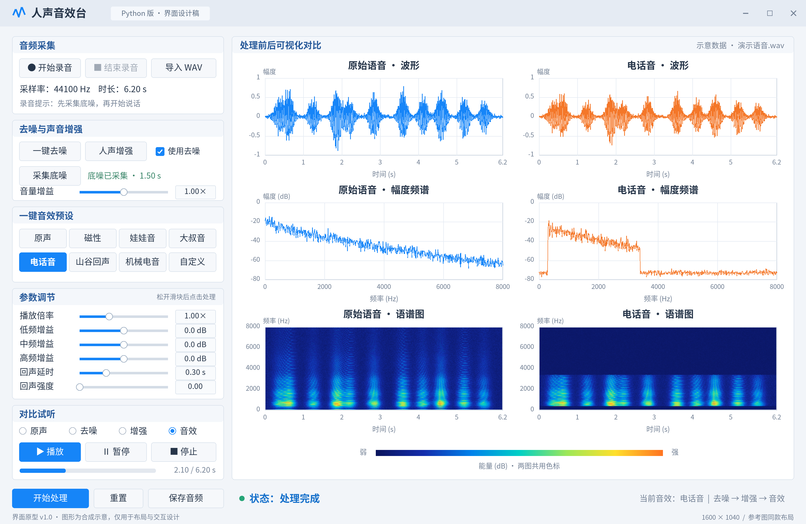

# 智能人声音效台：Python 界面设计说明

版本：v1.0  
日期：2026-10-20  
用途：数字信号处理综合实验的界面评审与后续开发依据。

## 1. 设计稿



- [PNG 效果图](界面设计.png)：3200 × 2080，便于预览、插入 PPT。
- [SVG 设计稿](界面设计.svg)：逻辑尺寸 1600 × 1040，界面文字、控件和曲线可缩放；语谱图为内嵌位图。
- [生成脚本](build_preview.py)：使用 Python、NumPy、Pillow 生成设计稿。

**本次交付是静态界面原型。按钮、滑块、播放进度和音频图均为设计示意，未接入麦克风、播放器或 DSP 算法。图中的“处理完成”是要展示的界面状态，不代表已经完成实际音频处理。**

## 2. 与参考图的对应关系

沿用用户提供的参考界面：浅灰窗口、白色分组面板、蓝色主按钮；左侧从上到下为音频采集、去噪与增强、音效预设、参数调节、对比试听，底部为开始处理、重置、保存；右侧按三行两列展示波形、幅度频谱和语谱图。原声用蓝色，处理结果用橙色。

保留全部核心操作位置，并增加独立“采集底噪”入口、中频增益及明确的底噪状态。当前设计展示“电话音”预设选中、音效结果可试听的场景。机械电音为扩展项，实际基础版本未实现时应置灰并注明“扩展功能”。

## 3. 布局与视觉规范

| 区域 | 逻辑尺寸或位置 | 内容 |
| --- | --- | --- |
| 顶栏 | 高 52 px | 应用名称、Python 版标识、窗口控制 |
| 左侧控制区 | x=24，宽 420 px | 五组操作面板及底部执行按钮 |
| 右侧分析区 | x=460，宽 1116 px | 原声与当前结果的六幅分析图、公共色标 |
| 底部状态区 | y≈980 px | 处理状态、当前音效和处理链路 |

- 背景：`#F2F5F9`；面板：白色；边框：`#D8E1EB`。
- 主色与原声：`#1685F8`；处理结果：`#F47729`；正文：`#263549`。
- 中文字体优先采用思源黑体／Noto Sans CJK SC，缺失时使用系统中文无衬线字体。
- 标题约 18–22 px，控件文字约 16–17 px，坐标刻度约 13 px。
- 实际 PySide6 界面使用布局管理器与可伸缩绘图区，避免将全部控件绝对定位。小窗口中左侧允许滚动，六幅图保持三行两列；坐标轴与文字不得相互覆盖。

## 4. 控件设计

### 4.1 音频采集

| 控件 | 行为 | 状态规则 |
| --- | --- | --- |
| 开始录音 | 检查输入设备，开始采集语音 | 录音时禁用导入、处理和其他采集操作 |
| 结束录音 | 停止采集，生成新的原声数据 | 仅录音时启用；成功后清空旧处理缓存 |
| 导入 WAV | 读取文件，显示采样率、声道和时长 | 用户取消选择时保留原数据 |
| 音频信息 | 显示实际采样率和时长 | 设计稿示例为 44100 Hz、6.20 s |

录音目标为单声道；优先尝试 44.1 kHz，设备不支持时采用其支持的采样率。导入立体声先明确提示将转为单声道。硬件采样率与内部处理采样率分别记录，转换不得只修改采样率标签。

### 4.2 去噪与声音增强

| 控件 | 行为 |
| --- | --- |
| 采集底噪 | 独立采集约 1.5 秒纯环境噪声，并显示状态；不可覆盖原声 |
| 一键去噪 | 使用有效底噪运行谱减，更新去噪缓存及其下游结果状态 |
| 使用去噪 | 决定增强阶段的输入来自去噪结果还是原声 |
| 人声增强 | 按当前配置进行归一化、三段均衡和音量增益处理 |
| 音量增益 | 线性增益 0.00×–2.00×，默认 1.00× |

第一版把“人声增强”定义为显式执行动作：默认先做峰值归一化，再做均衡和用户增益；全静音保持静音。详细的归一化开关和去噪强度可放入该按钮关联的设置弹窗，主窗口保持与参考图相似。

底噪缺失时，点击去噪应提示先采集或从原声选取纯噪声片段。不能未经确认把录音开头当作纯噪声。底噪和语音采样率不同时先重采样，再使用相同 STFT 配置估计噪声谱。

### 4.3 一键音效预设

| 预设 | 处理思路 | 优先级 |
| --- | --- | --- |
| 原声 | 旁路音效模块；试听原声仍使用下方“原声”选项 | 基础 |
| 磁性 | 适度提升低频、衰减高频 | 基础 |
| 娃娃音 | 提高倍率，搭配均衡 | 基础 |
| 大叔音 | 降低倍率，搭配均衡 | 基础 |
| 电话音 | 约 300–3400 Hz 带通，截止频率根据采样率约束 | 基础 |
| 山谷回声 | 延时衰减叠加，保留尾音 | 基础 |
| 机械电音 | 环形调制等效果 | 扩展 |
| 自定义 | 表示用户手动修改了参数 | 基础 |

预设加载参数并同步全部滑块和数值。手动改变参数后，预设选中状态转为“自定义”。预设的具体音色值在开发时试听调整，不把风格名称等同于真实说话人身份转换。

### 4.4 参数调节

| 参数 | 范围 | 默认值 | 说明 |
| --- | --- | --- | --- |
| 播放倍率 | 0.50×–2.00× | 1.00× | 基础版同时改变速度和音高；必须渲染到音频结果 |
| 低频增益 | −12–+12 dB | 0.0 dB | 约 300 Hz 以下 |
| 中频增益 | −12–+12 dB | 0.0 dB | 约 300–3000 Hz |
| 高频增益 | −12–+12 dB | 0.0 dB | 约 3000 Hz 以上 |
| 回声延时 | 0.00–1.00 s | 0.30 s | 换算为整数样本延迟 |
| 回声强度 | 0.00–0.80 | 0.00 | 0 表示无回声；首版采用有限次叠加 |

滑块与数值输入框双向同步。拖动时更新数字，点击“开始处理”统一生成结果。图中电话音参数为倍率 1.00×、三段增益 0 dB、回声强度 0；电话带通属于预设内部效果。

### 4.5 对比试听与执行操作

- 原声／去噪／增强／音效：选择相应缓存，不重复运行算法；选择改变时停止旧播放并从新结果开头开始。
- 播放：从当前位置继续；到末尾后再次点击从头开始。
- 暂停：保留播放位置；停止：停止并归零。
- 进度条：反映实际输出进度。第一版只显示进度，不支持拖动跳转。
- 开始处理：获取一份参数快照，按所选处理链路计算；运行期间禁止重复提交及修改处理参数。
- 重置：恢复默认参数、关闭去噪输入、选择原声预设，保留原声及底噪；清除处理缓存，停止播放并回到原声。
- 保存音频：导出当前所选、有效的试听数据为 WAV，文件与试听一致；建议文件名包含阶段或音效。

## 5. 图形显示规范

| 图形 | 数据与坐标 | 比较规则 |
| --- | --- | --- |
| 波形 | 时间（s）、幅度 | 两列采用相同幅度范围；各自显示真实时长 |
| 幅度频谱 | 频率（Hz）、幅度（dB） | 相同窗函数、幅度标定和纵轴范围，不分别按各自峰值归零 |
| 语谱图 | 时间（s）、频率（Hz）、能量（dB） | 相同窗长、帧移、参考值与颜色范围，共用色标 |

设计稿为复现参考图的观感，仅显示 0–8000 Hz。实际界面明确标注该显示范围，采样率足够时可提供“完整频段”切换；低采样率输入的频率轴不超过奈奎斯特频率。

示意图中的电话音在通带外表现为低能量，表达滤波目标；所有曲线和热图都是合成示意，不能用于说明真实去噪效果、SNR 或音效质量。

## 6. 应用状态与处理链路

```text
录音或导入 → 原声缓存
                  ├─ 底噪估计 → 去噪缓存
                  └─ 由“使用去噪”选择增强输入
                              ↓
                         增强缓存
                              ↓
                         音效缓存

四阶段缓存 → 试听选择 → 播放与分析图 → 导出当前结果
```

| 状态 | 界面表现 |
| --- | --- |
| 无音频 | 可录音、导入、采集底噪；处理、播放和保存禁用 |
| 录音中 | 结束录音启用，显示采集时长；禁止其他采集和处理 |
| 有原声 | 原声试听、分析、保存可用；其他阶段按缓存状态启用 |
| 处理中 | 显示当前阶段，禁用重复操作；界面仍可刷新 |
| 处理完成 | 启用有效阶段的试听，刷新当前结果列 |
| 参数已修改 | 下游缓存失效；禁止试听或导出过期结果，提示重新处理 |
| 设备或处理错误 | 显示可读原因，恢复可操作状态，不覆盖已有有效原声 |

更换原声后清空处理结果。不同环境录制的旧底噪可能不适用，应标记待确认；更换设备或环境后建议重新采集。任何处理都从对应上游数据重算，不在旧输出上无限叠加。

## 7. Python 实现映射

| 层次 | 建议模块 | 职责 |
| --- | --- | --- |
| 界面 | PySide6 | 分组面板、按钮、滑块、数值框、状态提示 |
| 绘图 | PyQtGraph | 波形与频谱曲线、语谱图 ImageItem、公共色标 |
| 文件 | soundfile | WAV 读写 |
| 音频设备 | sounddevice | 采集、输出、设备检查 |
| 算法 | NumPy、SciPy | STFT、谱减、FIR、重采样、延时叠加 |
| 状态 | dataclass 等轻量结构 | 原声、阶段缓存、参数和有效性 |
| 后台任务 | Qt 工作线程与信号 | 长耗时算法计算，完成后通知主线程更新 |

GUI 仅在主线程更新。音频回调只搬运预分配缓冲数据，不做绘图、整段滤波或文件写入。播放器显式维护样本位置，关闭窗口时释放设备并安全收尾工作线程。

## 8. 开发与验收顺序

1. 实现同款布局，先接 WAV 导入、原声波形、播放与保存。
2. 接入录音和底噪采集，确认设备异常可以恢复。
3. 实现电话音、倍率和回声，验证导出与试听一致。
4. 实现谱减、增强和四阶段缓存，验证上游变化会使下游失效。
5. 完成六幅图及公共色标，验证比较标定一致。
6. 基础功能稳定后接机械电音、多重回声或独立变调。

验收重点：按钮状态正确；录音和播放不冻结界面；暂停继续位置正确；电话滤波通带符合设置；回声尾音不丢失；静音和极短音频不崩溃；修改参数后无法导出旧结果；人工加噪测试保留干净参考以计算 SNR。

## 9. 边界与参考

本说明覆盖界面和交互设计，尚未实现应用、算法或功能测试。课程原文要求 MATLAB GUI，采用 Python 的课程验收口径需与老师确认。

- Qt 线程与信号示例：https://doc.qt.io/qtforpython-6.8/examples/example_widgets_thread_signals.html
- PyQtGraph：https://www.pyqtgraph.org/
- sounddevice 流 API：https://python-sounddevice.readthedocs.io/en/latest/api/streams.html
- soundfile：https://python-soundfile.readthedocs.io/en/latest/
- SciPy ShortTimeFFT：https://docs.scipy.org/doc/scipy/reference/generated/scipy.signal.ShortTimeFFT.html

## 10. 重新生成效果图

依赖：Python 3、NumPy、Pillow，以及脚本中指定的 Noto Sans CJK 中文字体。生成脚本属于设计资产工具，不是音效台应用。

```bash
python3 design/build_preview.py
```

输出会更新本目录的 `界面设计.png` 与 `界面设计.svg`；如需保留旧版本，请先复制另存。
