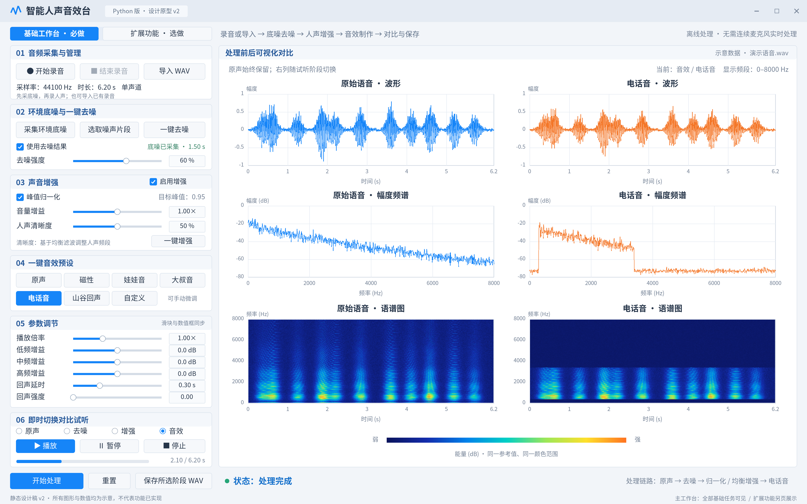
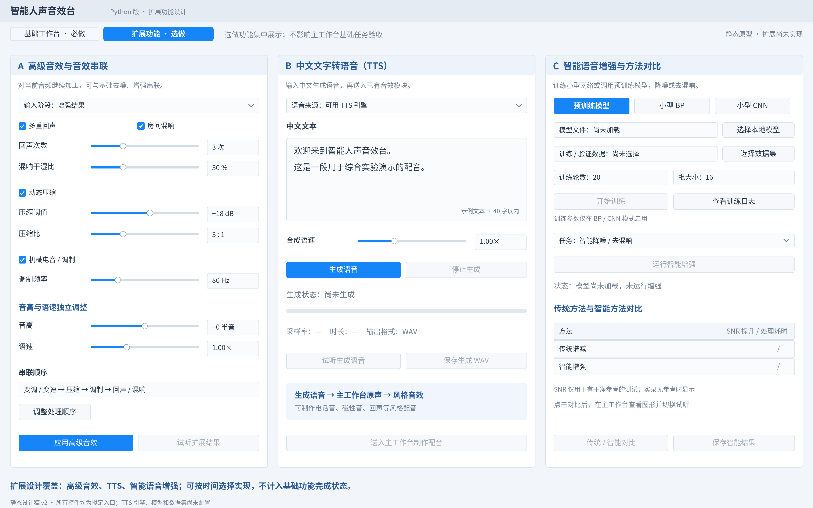

# 智能人声音效台：实验要求与界面设计

版本：v2.0  
日期：2026-10-20  
实现方向：Python 桌面应用，PySide6 + NumPy/SciPy。  
设计原则：参考图片的布局与配色，按实验原文安排功能入口。

> 实现选型更新：检查本机已有环境后，采用 PyQt5 + Matplotlib + QtMultimedia + SciPy WAV，复用 Conda base，增加输出设备选择。下面保留已确认的完整功能设计；实际已实现范围以 [README](../README.md) 和 [开发进度](../docs/开发进度.md) 为准。

> 2026-10-22运行界面已按课程要求整理为基础工作台和三个拓展子页，DeepFilterNet3移入智能降噪。请查看[当前界面、操作与真实截图](../docs/课程界面与智能对比.md)；本文件的v2静态稿保留为早期设计记录。

> 用户已选择第一版浅色草图并落实到Qt界面，见[选定草图](light-v3/用户选定草图.png)与[浅色工作台设计及验收](../docs/浅色工作台设计与验收.md)。下面的v2图片仅保留作早期记录。

## 1. 交付范围与预览

本次交付为两张静态设计稿与本说明。按钮、滑块、数据、状态和图形均为设计示意，尚未接入音频设备、DSP、TTS 或模型。**界面覆盖要求不等于功能已经实现。**

### 主工作台：全部基础任务直接可见



### 扩展页：选做任务各有明确入口



| 文件 | 用途 |
| --- | --- |
| [主工作台 PNG](界面设计.png) | 高清预览、插入 PPT |
| [主工作台 SVG](界面设计.svg) | 缩放查看，文字与控件为矢量，语谱图内嵌位图 |
| [扩展页 PNG](扩展功能设计.png) | 查看全部选做入口 |
| [扩展页 SVG](扩展功能设计.svg) | 扩展页缩放查看 |
| [生成脚本](build_preview.py) | 用 Python、NumPy、Pillow 重新生成两页设计稿 |

两页逻辑尺寸均为 1920 × 1200，PNG 为 3840 × 2400。上一版保存在 `archive_v1/`，本说明对应当前 v2 设计。

## 2. 基础任务逐条对应

下表以原始实验要求的五项基础任务为依据。每个必需动作在主工作台都有可见入口，不再把归一化或清晰度调整藏进弹窗。

| 编号 | 实验要求 | 界面位置与控件 | 实现后的验收方式 |
| --- | --- | --- | --- |
| B1.1 | 录音 | 01 音频采集与管理：开始录音、结束录音 | 录音结束生成原声，显示实际信息 |
| B1.2 | WAV 文件导入 | 01：导入 WAV | 读取文件后可试听、处理 |
| B1.3 | 播放、暂停、停止 | 06 即时切换对比试听：三个独立按钮 | 暂停保留位置，停止归零 |
| B1.4 | 保存 | 左下：保存所选阶段 WAV | 导出原声或任一有效阶段，与试听一致 |
| B1.5 | 采样率与时长 | 01：采样率、时长、声道信息 | 新录音或导入后即时更新 |
| B2.1 | 采集环境底噪 | 02：采集环境底噪、底噪状态与时长 | 底噪与人声分开存储 |
| B2.2 | 估计并减弱噪声 | 02：一键去噪、去噪强度数值滑块 | 使用底噪谱运行谱减，可调强度 |
| B2.3 | 去噪后试听 | 06：去噪阶段 | 切换到去噪缓存直接试听 |
| B2.4 | 去噪后继续音效处理 | 02：使用去噪结果；底部处理链路 | 后续增强、音效使用去噪输出 |
| B3.1 | 音量增益 | 03 声音增强：音量增益滑块与数值 | 0–2 倍调整响度，并控制过载 |
| B3.2 | 峰值归一化 | 03：峰值归一化复选框、目标峰值 0.95 | 启用时非静音输入归一化；静音安全通过 |
| B3.3 | 基于均衡滤波的人声清晰度 | 03：人声清晰度滑块、一键增强 | 控制人声中频提升、适量低频抑制 |
| B4.1 | 带数值显示的参数滑块 | 02、03、05 | 滑块与数值框双向同步，输入受范围约束 |
| B4.2 | 播放倍率 | 05：播放倍率 | 修改音频真实时长与音高，试听和导出一致 |
| B4.3 | 频段增益 | 05：低、中、高频增益 | 独立均衡微调 |
| B4.4 | 回声延时与强度 | 05：回声延时、回声强度 | 延迟样本与衰减强度按参数变化 |
| B4.5 | 磁性、娃娃音、大叔音、电话音、山谷回声预设 | 04 一键音效预设：五种独立按钮 | 点击加载参数，处理后能辨别对应风格 |
| B4.6 | 手动微调 | 04 自定义、05 参数调节 | 手动更改后显示自定义，待重新处理 |
| B5.1 | 原声、去噪、增强、音效结果即时切换 | 06：四个阶段选择 | 使用缓存，切换无需重新运算 |
| B5.2 | 处理前后波形 | 右侧第一行 | 左列原声、右列当前选中阶段 |
| B5.3 | 处理前后频谱 | 右侧第二行 | 使用相同标定比较频带变化 |
| B5.4 | 处理前后语谱图 | 右侧第三行、公共能量色标 | 时间、频率、能量变化可比 |
| B5.5 | 不要求连续麦克风实时处理 | 顶部离线处理说明、开始处理按钮 | 录完或导入后处理，计算放后台 |

## 3. 选做任务逐条对应

选做入口集中在“扩展功能”页。开发顺序以基础任务为先，未实现模块应禁用并显示未实现说明，不能用静态按钮表示功能已完成。

| 原文选做项 | 扩展页入口 | 范围 |
| --- | --- | --- |
| 多重回声 | A：多重回声、回声次数 | 多次延迟衰减叠加，延时与强度继承基础参数 |
| 房间混响 | A：房间混响、混响干湿比 | 选择的混响算法按干湿比与原声混合 |
| 机械电音 | A：机械电音／调制、调制频率 | 环形调制等可解释的 DSP 效果 |
| 动态压缩 | A：动态压缩、阈值、压缩比 | 控制较大动态范围 |
| 音效串联 | A：串联顺序、调整处理顺序 | 串联已启用模块，明确执行顺序 |
| 音高与语速独立调整 | A：音高、语速两个滑块 | 与基础倍率区分，可单独变调或变速 |
| 输入中文生成语音 | B：中文输入框、引擎选择、合成语速、生成语音 | 引擎是否离线可用取决于后续选型 |
| TTS 接入音效模块、制作配音 | B：试听、保存、送入主工作台制作配音 | 生成语音进入原声阶段，再套用音效 |
| 训练小型 BP／CNN | C：模型模式、数据集、训练轮数、批大小、训练与日志 | 只在相应训练模式启用训练参数 |
| 调用预训练模型 | C：预训练模型、选择本地模型 | 模型加载成功且音频有效后才能运行 |
| 智能降噪或去混响 | C：任务选择、运行智能增强 | 按模型实际支持的任务启用选项 |
| 与传统方法对比 | C：方法比较表、传统／智能对比 | 将两种结果送入主工作台对比图与试听 |
| 自主设计其他功能 | 02 的纯噪声片段选择、缓存有效性管理、分阶段导出 | 项目自定义便利功能，可在汇报中说明 |

智能对比支持有干净参考时的 SNR 提升、处理耗时；无干净参考的真实录音不显示虚构 SNR，使用试听和可视化比较。设计稿指标为“—”，并无真实测量。

## 4. 主工作台交互细则

### 4.1 音频与底噪

1. “开始录音”前检查设备；“结束录音”仅采集时启用。录音期间禁用导入与并发采集。
2. 原声与底噪分别存储。采集底噪不会覆盖语音。也可在原声中指定一段纯噪声，不默认认为开头是静音。
3. 第一版处理单声道。导入立体声时明确提示转换；采样率保留，底噪不匹配时重采样到当前处理采样率。
4. 无有效底噪时禁用一键去噪，或点击时给出明确提示；不能把无底噪状态显示为已去噪。
5. 无音频时禁用处理、播放、保存；取消文件选择不丢失已有数据。

### 4.2 去噪与增强

| 控件 | 范围与规则 |
| --- | --- |
| 去噪强度 | 0–100%，示例 60%；映射到谱减系数并使用谱底，具体映射待试听验证 |
| 使用去噪结果 | 勾选时后续处理以去噪缓存为输入；未勾选时绕过去噪 |
| 启用增强 | 决定是否执行归一化、清晰度、均衡和用户增益阶段 |
| 峰值归一化 | 可独立开关，启用时目标峰值固定 0.95；目标是本版设计值，不是实验强制数值 |
| 音量增益 | 0.00–2.00×，默认 1.00×；在归一化之后应用，避免被再次归一化抵消 |
| 人声清晰度 | 0–100%，默认 0 为中性，设计示例 50%；通过均衡响应调节人声频段 |
| 一键去噪／一键增强 | 执行到对应阶段；更新该阶段缓存，并使依赖它的下游缓存失效 |

清晰度和三段均衡都作用于增强阶段：先用清晰度生成一组基础均衡响应，再叠加用户低、中、高频 dB 调整。手动均衡显示的是额外调整量，因此清晰度为 50% 时三个手动增益仍可显示 0 dB。关闭增强时这些值保留但不生效，控件置灰。

### 4.3 音效与参数

| 参数 | 范围 | 默认 |
| --- | --- | --- |
| 基础播放倍率 | 0.50–2.00× | 1.00× |
| 低、中、高频增益 | 各 −12–+12 dB | 各 0 dB |
| 回声延时 | 0–1.00 s | 0.30 s |
| 回声强度 | 0–0.80 | 0 |

基础倍率同时改变速度与音高。独立变调／变速是扩展页的两个控制，不能只改播放设备采样率而让保存文件恢复原效果。

磁性为低频提升与高频衰减；娃娃音、大叔音为倍率与均衡组合；电话音采用约 300–3400 Hz 带通，截止频率随采样率约束；山谷回声采用延时衰减叠加并保留尾音。预设需要在实际语音上试听调优，不能承诺真实说话人身份转换。

选择预设会同步相关开关与参数，必要时自动启用增强；手动调节后切换到自定义。“原声”预设仅旁路音效阶段，保持此前去噪、增强配置；完全未经处理的原声从 06 的“原声”阶段选择。

### 4.4 处理、试听与导出

- “开始处理”保存参数快照，依次生成去噪、增强、音效缓存。禁用重复提交与运行期间调参，GUI 保持响应。
- 四阶段选择读取缓存，并同步右列的阶段名、三幅图和真实时长；左列始终为原声。
- 切换阶段先停止旧播放，再从新阶段开头开始。暂停保留样本位置，停止归零。
- 无效或过期阶段禁用试听、绘图更新与导出，显示“待处理”。不把旧音频和新参数混在一起。
- “保存所选阶段 WAV”导出当前有效缓存，允许保存原声或任一处理阶段；与实际试听数据一致。
- “重置”保留原声和底噪，恢复默认参数与旁路状态，清空下游缓存，停止播放并选中原声。

## 5. 可视化规范

- 波形使用共同幅度范围，分别显示真实时间轴；倍率改变或回声尾音可能造成时长不同。
- 幅度频谱使用相同窗函数、幅度标定与 dB 参考，不能对每列单独归一化后声称幅度变化真实可比。
- 语谱图使用相同 STFT 设置、dB 参考与色标，附公共能量条。
- 本设计展示 0–8000 Hz，并已在右上标注；实际低采样率输入不超过奈奎斯特频率。可另提供完整频段模式。
- 设计图中的波形、频谱、语谱图为分别构造的合成示意，不是同一真实信号的测量，不能用于算法验收。正式软件必须从同一份阶段缓存生成三类图。

## 6. 状态与数据流

```text
录音 / 导入 WAV → 原声
环境底噪 / 纯噪声片段 → 噪声谱估计
原声 + 噪声谱 → 去噪结果（可绕过）
选中的上游输入 → 归一化 → 清晰度与均衡 → 音量增益 → 增强结果
增强结果 → 倍率 / 电话滤波 / 回声等 → 音效结果
各阶段缓存 → 四阶段试听、六图比较、所选阶段导出

TTS → 新的原声
高级音效 → 扩展结果
智能模型 → 智能结果 → 与传统方法对比
```

| 状态 | 可见反馈 |
| --- | --- |
| 无音频 | 允许录音／导入／底噪采集；其他动作按依赖禁用 |
| 录音中 | 时长增加，结束录音可用 |
| 待处理 | 原声可用，未生成阶段置灰 |
| 处理中 | 显示当前计算阶段，阻止重入 |
| 处理完成 | 显示当前结果和链路 |
| 参数已改 | 下游缓存失效，提示重新处理 |
| 设备错误 | 可读提示，释放资源，保留有效音频 |
| 模型／TTS 未就绪 | 禁用依赖它的操作，不能显示虚构结果 |

更换原声后清空处理缓存。更换设备、环境或语音来源后，旧底噪需重新确认是否适用。所有处理从有效上游数据重算，不在旧输出上不断叠加。

## 7. 实现映射与布局

| 部分 | 实现建议 |
| --- | --- |
| GUI | PySide6 分组控件、滑块、数值框与标签页 |
| 绘图 | PyQtGraph 曲线与 ImageItem，缓存分析结果 |
| 音频文件 | soundfile，WAV 读写 |
| 音频设备 | sounddevice，设备检查与输入输出流 |
| 基础算法 | NumPy / SciPy，STFT、谱减、FIR、重采样、延时叠加 |
| 独立变调／变速 | 后续评估 librosa 等方案 |
| 线程 | 主线程更新 GUI；Qt 工作线程计算；音频回调只搬运缓冲 |

主工作台左侧宽 480 px，右侧为六图分析区；扩展页为高级音效、TTS、智能增强三栏。实际应用使用布局管理器，较小窗口允许控制区滚动；不得把设计稿固定像素坐标直接当作所有屏幕的最终布局。基础和扩展清晰分组，窗口底部不出现虚构“功能完成率”。

配色沿用参考图：浅灰背景 `#F2F5F9`、白色面板、蓝色主按钮和原声 `#1685F8`、橙色结果 `#F47729`。中文优先使用思源黑体／Noto Sans CJK SC，设置系统字体回退。

## 8. 开发与测试顺序

1. 主工作台布局、导入、原声播放与保存。
2. 录音、环境底噪采集、纯噪声片段选择。
3. STFT 无修改重建验证，再加入谱减。
4. 归一化、清晰度、均衡、增益及其作用顺序。
5. 倍率、五种预设、回声、参数同步。
6. 四阶段缓存与六图联调，处理线程与错误恢复。
7. 按剩余时间选择扩展；优先多重回声或独立变调。

关键验证：静音不除零、短音频可处理、常见采样率和立体声导入正确、暂停继续位置一致、电话通带受采样率约束、回声尾音不截断、调整参数使旧结果失效、保存与试听一致。去噪客观测试使用已知干净参考的人工加噪数据；真实录音以试听和图形变化为主。

## 9. 汇报要求与范围边界

实验材料还有组织与提交要求，它们属于项目交付而非音频软件控件，不在工作台加入虚假的“完成汇报”按钮。

| 要求 | 对应交付安排 |
| --- | --- |
| 2 人一组，汇报分工 | 如实记录实际开发、测试与材料贡献；当前由一人先完成主体 |
| GUI、程序与功能测试 | 本设计为 GUI 依据；代码实现与测试记录仍需后续完成 |
| 答辩 PPT | 使用最终实测界面截图、处理链路、结果与分工；不把本示意图作为实测证据 |
| 讲述约 4 分钟、提问 1 分钟，地点 303 | 按原始材料准备演示，具体现场安排以教师通知为准 |

课程原文要求 MATLAB GUI；本项目按用户选择设计为 Python，语言变更的课程验收口径需与教师确认。界面设计保留可解释的传统 DSP 路线，神经网络属于选做。

## 10. 参考与重新生成

- [Qt 线程与信号示例](https://doc.qt.io/qtforpython-6.8/examples/example_widgets_thread_signals.html)
- [PyQtGraph](https://www.pyqtgraph.org/)
- [sounddevice 流 API](https://python-sounddevice.readthedocs.io/en/latest/api/streams.html)
- [soundfile](https://python-soundfile.readthedocs.io/en/latest/)
- [SciPy ShortTimeFFT](https://docs.scipy.org/doc/scipy/reference/generated/scipy.signal.ShortTimeFFT.html)

生成脚本需要 Python 3、NumPy、Pillow 和其中指定的 Noto Sans CJK 字体；它是设计资产工具，不是音效台程序。

```bash
python3 design/build_preview.py
```

该命令更新两页 PNG 与 SVG；上一版保存在 `archive_v1/`。
